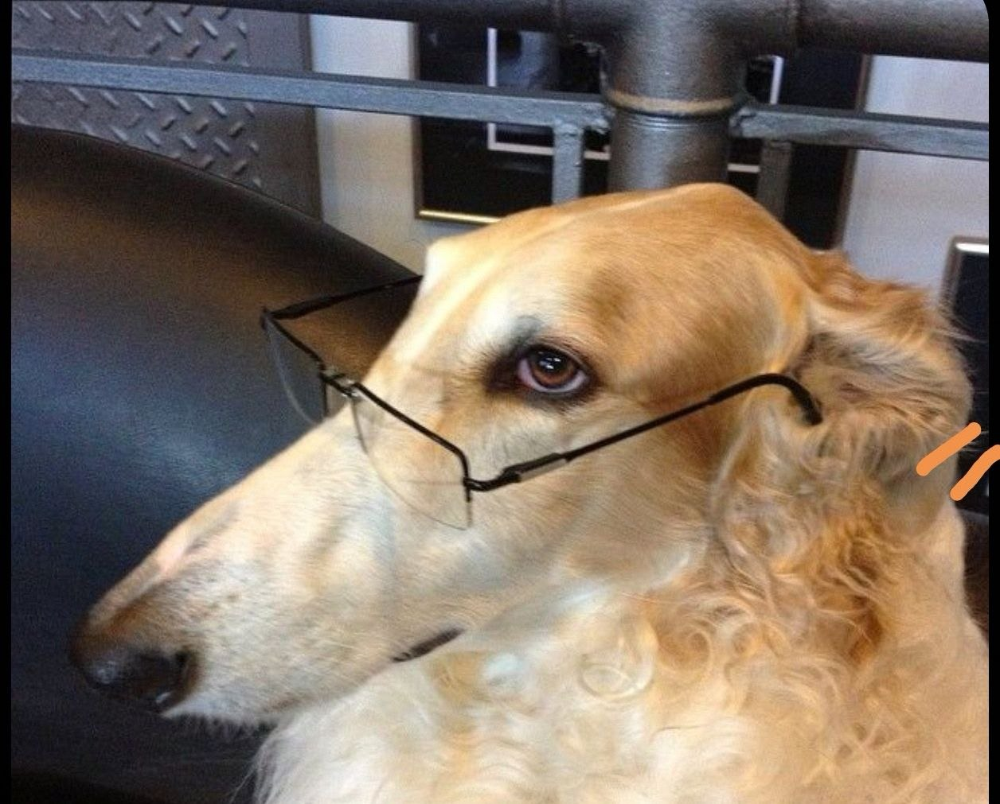

# Привет, я Елена! 👋

## Обо мне

Я начинающий тестировщик. Учусь в Нетологии, изучаю ручное тестирование веб-приложений.

## Мои навыки

- Ручное тестирование
- Составление тест-кейсов
- Работа с баг-трекинговыми системами
- Git и GitHub

## Контакты

- **Email:** elenanna@example.com
